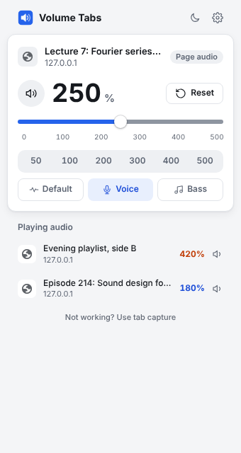
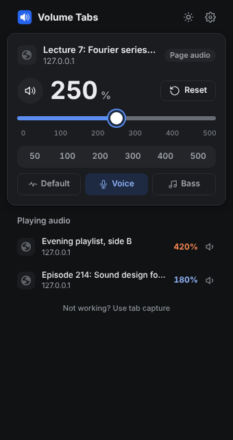

# Volume Tabs

An open-source browser extension that makes any tab louder, up to **500%**, for **Chrome** and **Firefox**. No tracking, no data collection, no network requests.

<p align="center">
  
  
</p>

## Features

- **0% to 500% volume** per tab, in 1% steps: slider, mouse wheel (Shift for 1% steps), arrow keys, or type the number.
- **Sound modes**: *Default* (untouched), *Voice* for clearer dialogue and podcasts, or *Bass* for music.
- **Playing tabs list**: every tab that is playing audio, with its boost level. Click one to switch to it.
- **Per-site memory**: the level you used on a site is saved locally. *Restore* brings it back in one click, *Reset* returns to 100%. Optional automatic restore.
- **Keyboard shortcuts**: `Alt+Shift+Up` / `Alt+Shift+Down` change the volume by 10%, `Alt+Shift+0` resets it. In the popup: arrow keys, `M` to mute, `0` to reset.
- **Toolbar badge** shows the current boost of each tab.
- **Light and dark themes**: follows the system on first use, then a single toggle in the header.
- **English and Turkish** interface.
- **Fullscreen keeps working in Chrome** in most cases. See [How it works](#how-it-works).

## Privacy and security

- **No data collection.** No analytics, telemetry, servers or ads. The extension makes **no network requests**.
- **No remote code**: no `eval`, no CDN, no third-party libraries. There is no bundler or minifier, so the shipped code is exactly the code in `src/`.
- **Minimal access**: no permanent access to websites. A page is only touched when you open the popup on that tab (`activeTab`), and its content is never read.
- Saved site levels stay in your browser (`storage.local`) and can be cleared in Settings. Per-tab state is cleared when the browser closes.
- Strict Content Security Policy and no `web_accessible_resources`, so websites cannot detect or call the extension.

See [PRIVACY.md](PRIVACY.md) and [SECURITY.md](SECURITY.md).

### Permissions

| Permission | Why |
| --- | --- |
| `activeTab`, `scripting` | Process the audio of the tab you opened the popup on |
| `tabs` | Titles for the playing tabs list, and the site name for per-site memory |
| `storage` | Your settings and saved site levels (local only) |
| `tabCapture`, `offscreen` *(Chrome)* | Fallback for sites where the page's own players cannot be used |
| `favicon` *(Chrome)* | Show tab icons from Chrome's local cache, without network requests |
| `<all_urls>` *(Firefox, optional, off by default)* | Only if you enable it in Settings: re-apply the boost after reloads and work inside embedded players |

## Install

Until store listings are published, install from source. You need [Node.js](https://nodejs.org) 20 or newer; there are no other dependencies.

```bash
git clone https://github.com/cngil/volume-tabs.git
```

```bash
cd volume-tabs && npm run build
```

**Chrome, Edge, Brave:** open `chrome://extensions`, enable *Developer mode*, click *Load unpacked* and select `dist/chrome`.

**Firefox:** open `about:debugging#/runtime/this-firefox`, click *Load Temporary Add-on* and select `dist/firefox/manifest.json`. Temporary add-ons are removed when Firefox restarts; a permanent install requires the add-on to be signed by Mozilla (for example as an unlisted add-on on AMO).

`npm run package` writes store-ready zip files to `dist/`.

## How it works

Audio is processed with the browser's built-in [Web Audio API](https://developer.mozilla.org/docs/Web/API/Web_Audio_API):
`source -> gain (0-500%) -> bass shelf -> voice filters -> speakers` (the filters stay flat in Default mode)

There are two engines:

1. **Page audio** (Chrome and Firefox): the page's `<audio>` and `<video>` elements are routed through the chain. Fullscreen and everything else keep working. DRM-protected media and cross-origin media without CORS would turn silent if routed, so those elements are left untouched.
2. **Tab capture** (Chrome only): `chrome.tabCapture` captures the whole tab's audio and processes it in an invisible offscreen document. It works on every site, but Chrome keeps fullscreen video inside the window while a tab is captured and shows a capture indicator on the tab. Capture stops by itself a few seconds after the level returns to 100%.

In Chrome's *Automatic* mode, page audio is tried first and tab capture is the fallback. You can force tab capture in Settings, or switch engines for one tab from the popup.

**Firefox:** Firefox has no tab capture API, so only the page engine is available. DRM content (for example Netflix or Spotify) and cross-origin media without CORS cannot be boosted. This limitation applies to every extension of this kind on Firefox.

## Development

```text
src/
  background/   core.js (shared logic), chrome-backend.js, firefox-backend.js, page-host.js
  content/      page-engine.js, injected on demand into the controlled tab
  offscreen/    Chrome tab capture audio processing
  popup/        user interface
  shared/       audio chain, settings, storage
manifests/      base.json plus per-browser additions
scripts/        build.mjs (dependency-free build and zip)
```

```bash
npm test
```

```bash
npm run lint:firefox
```

The popup design follows [Impeccable](https://github.com/pbakaus/impeccable): product context lives in [PRODUCT.md](PRODUCT.md) and the visual system in [DESIGN.md](DESIGN.md).

Contributions are welcome. Please do not add dependencies, remote resources or network requests.

## License

[MIT](LICENSE)
